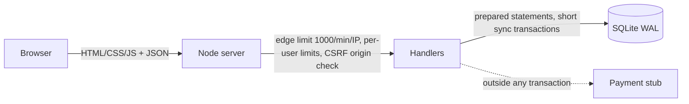

# Demo Shop — Backend Design (backend-expert-v1)

Zero-dependency Node app: `node:http`, `node:sqlite`, `node:crypto` (Argon2id). Non-interactive run: defaults used, assumptions listed below.

## Assumptions (none were confirmed by the user)

| # | Assumption | Source |
|---|---|---|
| A1 | ~500 shoppers/day, ~40 requests each, consumer peak factor ×10 | assumption (`capacity-and-rate-limits.md` defaults) |
| A2 | ~5% of shoppers order → ~25 orders/day | assumption |
| A3 | Single always-on server, single process, SQLite file | demo scope |
| A4 | Payment provider is a stub (`chargeStub`); `pm_card_declined` simulates a decline | demo scope |
| A5 | Argon2id at OWASP minimum: 19 MiB, 2 passes, 1 lane | [OWASP Password Storage Cheat Sheet](https://cheatsheetseries.owasp.org/cheatsheets/Password_Storage_Cheat_Sheet.html) (checked this session) |
| A6 | Served over plain HTTP locally; set `COOKIE_SECURE=1` behind HTTPS (adds `Secure`, `__Host-` prefix, HSTS) | — |
| A7 | No roles/admin portal in this demo: one role, `customer` | demo scope |

## Architecture



## Call Map and request budget

| Screen / trigger | Request | DB queries | Auth + owner check | Limit class | Verdict |
|---|---|---|---|---|---|
| Shop front (first paint) | `GET /api/screens/shop` (user + 24 products + cart) | 3 | optional session | read | **1 request** instead of 3 |
| Product page | `GET /api/products/:id` | 1 | public | read | needed |
| More products | `GET /api/products?cursor=` | 1 | public | read | keyset pagination, max 100 |
| Add/change quantity | `PUT /api/cart/items/:id` (returns full cart) | 3 | session; cart row is `user_id`-scoped | write | 1 request, **no refetch**; absolute quantity so double clicks are harmless |
| Remove item | `DELETE /api/cart/items/:id` | 2 | session | write | returns the cart |
| Pay | `POST /api/checkout` (+ `Idempotency-Key`) | ~8, 2 short transactions | session | checkout | 1 request |
| Order history | `GET /api/orders` | 2 (orders + all items in one `IN` query) | session, `user_id` in query | read | no N+1 |
| Order detail | `GET /api/orders/:id` | 2 | `WHERE id=? AND user_id=?` → 404 | read | needed |
| Login / logout / me | `POST /api/login`, `POST /api/logout`, `GET /api/me` | 1–3 | — | login / write / read | needed |

Idle traffic: **0 requests/second** per open tab (no polling). Updates: fetch on load, response of each mutation carries the new state. No live feature was requested, so no SSE/WebSocket.

## Capacity estimate (A1, A2)

```
Average RPS = 500 users × 40 req ÷ 57,600 s (16 active hours) ≈ 0.35 req/s
Peak RPS    = 0.35 × 10 ≈ 3.5 req/s   → design capacity ×3 ≈ 10 req/s
Writes/day  ≈ 25 orders + cart edits   → trivial for SQLite
Login cost  = ~145 ms CPU + 19 MiB per Argon2id hash → 10 logins/s would use ~1.5 CPU-seconds per second
```

Conclusion: one process is plenty. The real risks are **correctness** (double charge, oversell), **authorization** and **login floods** (Argon2 is deliberately expensive, so login is rate limited hard).

## Rate limits (in memory — shortcut: single instance; use Redis for several)

| Class | Applies to | Key | Limit |
|---|---|---|---|
| edge | everything under `/api` | IP | 1000 / min |
| login | `POST /api/login` | IP | 20 / min |
| login failures | wrong passwords | account (email) | 5 / 15 min, then 429 + `Retry-After`; success clears it |
| read | GET | user, else IP | 300 / min |
| write | cart changes, logout | user | 60 / min |
| checkout | `POST /api/checkout` | user | 10 / min |

Known trade-off: account-keyed lockout lets someone lock a victim out for 15 minutes by guessing wrong passwords. Acceptable for a demo; production should add per-IP+account keys, CAPTCHA, or step-up checks.

`RATE_MULT` env multiplies every limit — used only on staging so a load test can run with a few test accounts. Never set it in production.

## Auth model

- Server-side sessions: 256-bit random token in cookie `sid` (`HttpOnly; SameSite=Lax; Max-Age=8h`, plus `Secure` and `__Host-` prefix when `COOKIE_SECURE=1`). Only the **SHA-256 of the token** is stored.
- New session id on every login; logout deletes the row; expired rows purged at login.
- Unknown email and wrong password give the same answer and cost the same time (dummy hash).
- State-changing requests: `Origin` header must match `Host` (CSRF defence in depth).
- Authorization: every order lookup includes `user_id` in the SQL; "not yours" returns **404**.

## Data protection

| Data | Treatment |
|---|---|
| Passwords | Argon2id, per-user salt, parameters stored in the hash string (can be raised later) |
| Session tokens | Only SHA-256 stored |
| Card numbers | **Never stored or logged**; only a `pm_card_*` token name is accepted |
| Errors | `{error: code}`; 500s return only a `requestId`, stack stays in the server log |
| Headers | CSP (`default-src 'self'`, `frame-ancestors 'none'`), `nosniff`, `Referrer-Policy`, HSTS when HTTPS |

## Database plan

- Tables: `users`, `sessions`, `products`, `cart_items`, `orders`, `order_items`, `payments` (see `db.mjs`). Foreign keys on, WAL mode, `busy_timeout`.
- Integrity: `CHECK(stock >= 0)`, `CHECK(qty BETWEEN 1 AND 20)`, `UNIQUE(user_id, idempotency_key)`, `payments.order_id` primary key (one payment per order).
- Stock is only changed by `UPDATE ... SET stock = stock - ? WHERE id = ? AND stock >= ?` (atomic, never negative).
- Checkout: **transaction 1** reserves stock, creates a `pending` order and empties the cart → **payment call outside any transaction** → **transaction 2** marks `paid` (or restores stock and marks `failed` on decline).
- Idempotency: same key → same result (`201` first, `200` replay, `409 checkout_in_progress` while pending). No key → server makes one; the cart is consumed atomically, so a second click finds an empty cart (`409 cart_empty`).
- Indexes: `orders(user_id, created_at DESC)`; primary keys cover the rest.
- Backups: copy `shop.db` with SQLite `VACUUM INTO` / `.backup` (not done in the demo).

## Self-check results

`npm test` in `demo/shop`: 11 tests pass (3 runs in a row): catalog and 401s, generic login failure, one-request shop screen, 5 parallel checkouts with one key → 1 order, 4 parallel checkouts without a key → 1 order, last unit with two buyers → exactly one wins, declined card restores stock, empty cart / bad payment method, other user's order → 404, login lockout, body-size / origin / traversal / error leaks / headers.

## Not checked / risks

- A crash between transaction 1 and the payment call leaves a `pending` order holding stock → needs a reaper job (marked `shortcut:` in `server.mjs`).
- In-memory rate limits reset on restart and don't work across several processes.
- No email verification, password reset, MFA or admin portal (out of demo scope).
- Not load tested yet. Not tested over HTTPS.

---

## Test Handoff

### Endpoints
| Method | Route | Auth | Owner check | Limit class | Valid → expected | Invalid → expected |
|---|---|---|---|---|---|---|
| POST | /api/login | public | — | login (20/min/IP, 5 failures/15min/account) | 200 + `Set-Cookie` | 401 generic; 422 bad format; 429 + `Retry-After` |
| POST | /api/logout | session | — | write | 200, cookie cleared | — |
| GET | /api/me | session | — | read | 200 `{user}` | 401 |
| GET | /api/screens/shop | optional | — | read | 200 `{user,items,nextCursor,cart}` | — |
| GET | /api/products | public | — | read | 200, ≤ `limit` items | 422 bad `limit`/`cursor` |
| GET | /api/products/:id | public | — | read | 200 | 404 |
| GET | /api/cart | session | own cart only | read | 200 | 401 |
| PUT | /api/cart/items/:id | session | own cart only | write | 200 + full cart | 422 quantity not int 0–20; 404 unknown product; 409 more than stock; 413 body > 10 KB; 403 foreign `Origin` |
| DELETE | /api/cart/items/:id | session | own cart only | write | 200 + full cart | 401 |
| POST | /api/checkout | session | own cart only | checkout (10/min/user) | 201 order; 200 replay of same key | 409 `cart_empty` / `out_of_stock` / `checkout_in_progress`; 402 `payment_declined`; 422 bad payment method; 400 bad key |
| GET | /api/orders | session | `user_id` in query | read | 200 list (`limit` ≤ 100, `since`) | 401; 422 bad params |
| GET | /api/orders/:id | session | `WHERE id=? AND user_id=?` | read | 200 | 404 for missing **and** foreign orders; 401 |

### Authorization matrix
| Action | customer (owner) | other customer | anonymous |
|---|---|---|---|
| Browse products / shop screen | ✔ | ✔ | ✔ |
| View/change cart | own | own only | 401 |
| Checkout | own cart | own cart | 401 |
| View order | own | **404** | 401 |

### Security cases to test
- IDOR: customer B requests customer A's `/api/orders/:id` → 404; anonymous → 401. (`scripts/idor-check.mjs`)
- Session: forged/random/old cookie → 401; cookie flags `HttpOnly`, `SameSite=Lax`; logged-out cookie replayed → 401.
- Login: 6th wrong password for one account → 429; unknown email and wrong password give identical body.
- Input: quantity `0`, `-1`, `1.5`, `"1"`, `21`, `null`; huge body; invalid JSON; SQL/script strings in ids → 4xx, never 500.
- Tampering: client-sent `price`, `userId`, `status` in cart/checkout bodies ignored.
- Origin: `Origin: https://evil.example` on PUT/POST/DELETE → 403.
- Static: `/%2e%2e/server.mjs`, `/db.mjs`, `/shop.db` not served. No stack traces in any error body.

### Data integrity cases
- N parallel `POST /api/checkout` with the **same key** → exactly one order, one payment row. (`scripts/race.mjs`)
- N parallel checkouts **without a key** → exactly one order.
- Two buyers, last unit (`limited-print`, stock 1) → one `201`, one `409`; stock never < 0.
- Declined card (`pm_card_declined`) → `402`, stock restored, order `failed`, no payment row.
- A sold-out item stays in the loser's cart until removed (decide with the UI whether that is the right behaviour).

### Load targets (needs approval)
| Scenario | Rate | Duration | p95 | Errors |
|---|---|---|---|---|
| Browse + product pages | ~10 req/s (≈3× estimated peak) | 5 min | < 200 ms | < 0.1% |
| Checkout flow | ~2 orders/s | 2 min | < 600 ms | < 1% (409s for stock are expected) |
| Breakpoint | ramp until errors > 5% | auto-stop | — | find the first bottleneck |

### Environment and test data
`cd demo/shop && npm run seed && npm start` → http://localhost:3000. Users `alice@example.test` / `bob@example.test` (passwords in `seed.mjs`, demo only). Seed resets all data; `DB_PATH` selects the file; `PAY_DELAY_MS` changes the payment stub delay; `RATE_MULT` raises limits for staging load tests. Never run load tests against production or a real payment provider.
